# Synthetic Prostate MRI Generation with WGAN-GP (HipMRI 2D)

One-paragraph summary: what was built, the problem it solves, headline result
(e.g. "WGAN-GP reached SSIM X vs DCGAN Y with no evidence of memorisation"). - ADDED LAST
BASED ON RESULTS OF REPORT (like exec summary). 
> [!IMPORTANT]
> **Please review** the two notes within the **4.2 Pre-Processing** section to understand the difference in displayed results for
> `dcgan` and `wgan_gp` versus `wgan_gp_wide`.

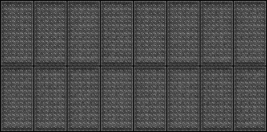
### Figure 1: Animation of Final WGAN - 250 Epochs of Training

## Contents
(optional table of contents linking to the sections below)

## 1. Feasibility Review
**Topic 2.4 - Image Generation: Synthetic Medical Cohorts and Privacy**
### 1.1 User Need, Scope and Acceptance Criteria
The purpose of this research is to provide additional medical imaging resources to medical researchers investigating 2D pelvic MRI slices. Through WGAN generation, new slices could be synthesised which replicate realistic tissue structures and remove the risk of violating patient privacy laws such as HIPPA and GDPR. Final intentions for this project are to determine whether the model can produce synthetic images that are safe, structurally sound and could plausibly be used for training. To address the fidelity vs memorisation vs privacy dilemma, testable acceptance criteria of the final model include:
- Structural Similarity Index of greater than 0.6 (SSIM > 0.6) across synthesised cohorts against reference anatomical slices.
- WGAN results are better than those of the baseline model.
- Nearest-neighbour distance audit and latent space interpolation, sample distribution should not be closer than test distribution.
- Peak VRAM < 4 GB and < 6 hours GPU training.
### 1.2 Model Choice and Course Concepts
The chosen model is the WGAN-GP which is Normal difficulty, on HipMRI 2D slices which are already split into test, train and validation sets. The baseline model is a DCGAN which is identical apart from the loss and Lipschitz constraint.
- Must implement Earth-Mover distance. This is part of what makes it a WGAN, providing a continuous distance (differentiable almost everywhere) that allows the critic to be trained towards optimality. We can then train with low likelihood of mode collapse and image generation improving for higher number of iterations.
- Critic must have Lipschitz constraint. Based on the paper this is the other requirement that allows the critic to have a continuous loss function to be optimised.
- To be a WGAN-GP rather than just a WGAN, the loss function for the critic must include a gradient penalty scaled by some lambda (this penalty directly incorporates the Lipschitz constraint).
- Starting parameters for the system are based on those noted in the WGAN-GP paper, α=0.0001,λ=10,m=64,n_CRITIC=5 where these are learning rate, gradient penalty lambda, batch size and number of critic iterations per generator iteration, respectively.
- Builds directly on course concepts involving DCGANs and WGANs (both covered in Week 9 lecture content) as well as loss/activation functions, hyperparameters and model evaluation methods.
### 1.3 Preliminary Feasibility Evidence
An initial data audit was completed using `data_audit.py`, which can be summarised into this table:

| **Measure** | **Train** | **Validate** | **Test** |
| --- | :---: | :---: | :---: |
| Slices | 11,460 | 660 | 540 |
| Patients | 31 | 4 | 3 |
| Slice Shapes | 256x128 (11,400), 256x144 (60) | 256x128 | 256x128 |
| Intensity Range (Sampled) | 0 – 1,150 | 0 – 565  | 0 – 617 |
| Median Per-Slice | 387.5 | 373 | 424 |
| Near-Empty Slices | 0% | 0% | 0% |

An analysis of this preliminary data audit can be found in **Section 4: Data**.
### 1.4 Risk, Budget and Fallback
The key technical risks associated with the project are:
- WGAN has a risk of unstable training results if a momentum-based optimiser (Adam) or high learning rates are used, placing some restrictions on model architecture and tuning parameters.
- Rangpur script delays due to high student traffic approaching the due date.
- Chosen parameters exceed GPU memory or provided training time, which may not become apparent until training failure occurs.
- Test set only has 3 patients which limits strong statements surrounding how well generalised the data is.
The next planned experiment is memory/time estimations followed by baseline model (DCGAN) implementation. In the case where proposed risks begin to impact the deliverables of the project, the DCGAN baseline can instead become the main project with a basic autoencoder becoming the new baseline. This is a different normal difficulty option under the same topic.

## 2. How It Works
Exact information about hyperparameters/how to run can be found in **Section 3: Usage**. This section instead summarises the general architecture of the system and the differences between the baseline and real model. For tabular summary of architecture, skip to **Section 2.3**.
### 2.1 DCGAN (Baseline)
For the baseline implementation a DCGAN was created using only the standard hyperparameters from the DCGAN paper. The generator goes through 4 layers of convolution, starting from latent space vector *z* and outputting a 128x64 image, matching the training images (see **Section 4.2** about pre-process downsampling). Batch normalisation is done between convolutions with ReLU activation functions being used until after the final convolution, which is a Tanh activation. The discriminator follows the same architecture in reverse, taking in a 128x64 image, and outputting a real or fake label. The key difference between the two is in the activation functions, as the discriminator uses LeakyReLU with a Sigmoid after the final convolution. BCELoss was utilised in the baseline model.
### 2.2 WGAN-GP
WGAN-GP maintains most of the same architecture as the DCGAN in its generator and critic, with the main differences being in the critic, which no longer has a final Sigmoid activation function and uses group normalisation instead of batch. We no longer use the sigmoid because we want the raw critic score rather than the probability. As for the normalisation, WGAN-GP uses gradient penalty, which is based on one image at a time, but batch normalisation normalises each image by the mean and variance of the whole batch, which breaks the gradient penalty.

Other major changes between the DCGAN and the WGAN-GP surround the loss function. While DCGAN uses BCELoss, WGAN-GP *must* use Wasserstein loss (which has separate equations for the loss of the critic vs loss of the generator). In addition, the critic loss also includes the gradient penalty component (the GP portion of WGAN-GP). Lipschitz constraint is obeyed through the usage of the gradient penalty, making this model a WGAN.

### 2.3 Architecture
**Generator** (identical in DCGAN/WGAN-GP)

| Layer | Operation | Output shape | Parameters |
|---|---|---|---|
| Input | Latent vector z ~ N(0, I) | 100 × 1 × 1 | – |
| 1 | ConvTranspose (8×4, stride 1) → BatchNorm → ReLU | 512 × 8 × 4 | 1,639,424 |
| 2 | ConvTranspose (4×4, stride 2) → BatchNorm → ReLU | 256 × 16 × 8 | 2,097,664 |
| 3 | ConvTranspose (4×4, stride 2) → BatchNorm → ReLU | 128 × 32 × 16 | 524,544 |
| 4 | ConvTranspose (4×4, stride 2) → BatchNorm → ReLU | 64 × 64 × 32 | 131,200 |
| 5 | ConvTranspose (4×4, stride 2) → Tanh | **1 × 128 × 64** | 1,024 |
| | | **Total** | **4,393,856** |

**Critic** (different in DCGAN/WGAN-GP)

| Layer | Operation | Output shape | Parameters |
|---|---|---|---|
| Input | Real or generated slice | 1 × 128 × 64 | – |
| 1 | Conv (4×4, stride 2) → LeakyReLU(0.2) | 64 × 64 × 32 | 1,024 |
| 2 | Conv (4×4, stride 2) → Norm* → LeakyReLU(0.2) | 128 × 32 × 16 | 131,328 |
| 3 | Conv (4×4, stride 2) → Norm* → LeakyReLU(0.2) | 256 × 16 × 8 | 524,800 |
| 4 | Conv (4×4, stride 2) → Norm* → LeakyReLU(0.2) | 512 × 8 × 4 | 2,098,176 |
| 5 | Conv (8×4, stride 1) | **1 × 1 × 1** | 16,384 |
| | | **Total** | **2,771,712** |

\* **Norm** is `BatchNorm2d` in the DCGAN discriminator and `GroupNorm(1, C)` (layer
normalisation) in the WGAN-GP critic. The DCGAN discriminator additionally ends with a
Sigmoid to output a probability; the WGAN-GP critic outputs an unbounded score.

## 3. Usage
### 3.1 Dependencies
All code was run with **Python 3.13** on Windows 11 with an **NVIDIA GeForce RTX 3080** (CUDA 13.1).

Third-party packages:

| Package | Version | Used by |
|---|---|---|
| torch | 2.14.0+cu130 | all model, training and evaluation code |
| torchvision | 0.29.0+cu130 | `train.py`, `predict.py` (saving image grids) |
| torchmetrics | 1.9.0 | `utils.py` (SSIM), `train.py` (FID) |
| torch-fidelity | 0.4.0 | required by torchmetrics' FID (Inception weights) |
| scipy | 1.18.1 | required by torchmetrics' FID |
| nibabel | 5.4.2 | `dataset.py`, `data_audit.py` (loading NIfTI slices) |
| numpy | 2.5.2 | `dataset.py`, `data_audit.py` (preprocessing / audit only) |
| matplotlib | 3.11.2 | `train.py` (loss, metric and histogram plots) |

Imports per file (standard-library modules in *italics*):

| File | Purpose | Imports |
|---|---|---|
| `modules.py` | Generator, DCGAN discriminator, WGAN-GP critic, weight initialisation | `torch.nn` only |
| `dataset.py` | `HipMRIDataset` (crop or downsample, clipping, scaling), `load_data` (DataLoader), `load_split` (whole split as a tensor) | *os*, *glob*, torch, `torch.utils.data`, `torch.nn.functional`, nibabel, numpy |
| `utils.py` | Shared evaluation helpers: `load_generator`, `invert_ssim`, `compute_fid`, `nearest_train`, `to_rgb_01`; `BEST_CHECKPOINTS`, `NUM_SAMPLES` | torch, `modules`, torchmetrics (SSIM) |
| `train.py` | Training (DCGAN, WGAN-GP), checkpoint validation, final testing, loss and metric plots; run configurations in `CONFIGS` | *os*, *json*, *time*, *argparse*, *pathlib*, torch (`nn`, `optim`), torchvision.utils, matplotlib, torchmetrics (FID), `dataset`, `modules`, `utils` |
| `predict.py` | Example usage of a trained model: samples, inversion reconstructions, nearest-neighbour pairs, latent interpolation, printed results | *json*, *argparse*, *pathlib*, torch, torchvision.utils, `dataset`, `train`, `utils` |
| `data_audit.py` | Standalone data audit (Section 1.3) | *os*, *re*, *collections*, nibabel, numpy |

### 3.2 Hyperparameters
Three configurations are compared; each is an entry in `CONFIGS` in `train.py`. First appearance of
difference in configuration of hyperparameters are bolded within the table.

| Hyperparameter | DCGAN (`dcgan`) | WGAN-GP standard (`wgan_gp`) | WGAN-GP tuned (`wgan_gp_wide`) |
|---|---|---|---|
| **Data & architecture** | | | |
| Preprocessing | Central 128×64 crop | Central 128×64 crop | **Whole slice, downsampled to 128×64** |
| Image size | 1 × 128 × 64 | 1 × 128 × 64 | 1 × 128 × 64 |
| Latent dimension (nz) | 100 | 100 | **128** |
| Generator / critic base width (ngf / ndf) | 64 / 64 | 64 / 64 | **128** / 64 |
| Generator parameters | 4,393,856 | 4,393,856 | **15,210,240** |
| Generator normalisation | BatchNorm | BatchNorm | BatchNorm |
| Discriminator / critic normalisation | BatchNorm | **GroupNorm(1, C) (layer norm)** | GroupNorm(1, C) (layer norm) |
| Discriminator / critic output | Sigmoid (probability) | **Linear (unbounded score)** | Linear (unbounded score) |
| Weight initialisation | N(0, 0.02) | N(0, 0.02) | N(0, 0.02) |
| **Objective** | | | |
| Loss | BCE (non-saturating G loss) | **Wasserstein + gradient penalty** | Wasserstein + gradient penalty |
| Gradient penalty weight (λ) | – | **10** | 10 |
| Critic updates per G update (n_critic) | 1 | **5** | 5 |
| **Optimisation** | | | |
| Optimiser | Adam | Adam | Adam |
| Learning rate (G and D) | 2 × 10⁻⁴ | **1 × 10⁻⁴** | 1 × 10⁻⁴ |
| Adam (β₁, β₂) | (0.5, 0.999) | **(0.0, 0.9)** | (0.0, 0.9) |
| Batch size | 128 | 128 | 128 |
| **Training length** | | | |
| Epochs | 50 | **250** | 250 |
| Generator updates per epoch | 90 | **18** | 18 |
| Total generator updates | 4,500 | 4,500 | 4,500 |
| Total critic / discriminator updates | 4,500 | **22,500** | 22,500 |
| Selected checkpoint (lowest validation FID) | epoch 50 | epoch 240 | epoch 250 |

The tuned configuration changes two things relative to the standard WGAN-GP: a wider generator
(more capacity) and downsampled data instead of the central-cropped data. Its results are therefore evaluated 
against equally downsampled test data and are not directly comparable with the centre-crop models.

### 3.3 Reproducing Results
**Data.**

Adjust `ROOT` in `dataset.py` to match the location of your base HipMRI folder. Ensure that 
`HipMRI/keras_slices_train`, `HipMRI/keras_slices_validate` and `HipMRI/keras_slices_test` all exist 
within the main HipMRI folder you direct `ROOT` to.

**Commands.**

Run from the project folder. `--run` selects a configuration from `CONFIGS`. The `CONFIGS` dictionary can be adjusted 
for chosen hyperparameters and can take an additional entry of `resume=[checkpoint_file]` if it desired to continue
training a previously trained model from a checkpoint.
All outputs go to `outputs/<run>/`.

| Step | Command | Output |
|---|---|---|
| Data audit | `python data_audit.py` | Printed split counts, shapes, intensities, patient overlap |
| Train | `python train.py --run dcgan --mode train` `python train.py --run wgan_gp --mode train` `python train.py --run wgan_gp_wide --mode train` | `checkpoints/` (every 25 epochs), `samples/epoch_NNN.png`, loss/metric plots, `resources.txt` |
| Validate (choose checkpoint) | `python train.py --run <run> --mode validate` | Validation FID per checkpoint, best checkpoint printed; `val_results_<run>.json` |
| Test (final values) | `python train.py --run <run> --mode test` | Test FID (with real-data floor), inversion SSIM, nearest-neighbour statistics; `test_results.json`, `nn_hist_<run>.png` |
| Visualise | `python predict.py --run <run>` | Loads the run's saved generator weights and the test split, then saves seeded sample grids, a latent interpolation, GAN-inversion reconstructions (with SSIM) and nearest-neighbour pairs. Also prints the run's `test_results.json`. |

After validating, set the chosen file for each run in `BEST_CHECKPOINTS` (`utils.py`) before
testing or running `predict.py`.

**Notes on reproduction.**
- Evaluation is seeded to ensure fair comparisons between models.
- To visualise/generate outputs for a certain saved model, go into `utils.py` and adjust the checkpoint
  for the chosen model inside `BEST_CHECKPOINTS`.
- The results in this report were produced with the pre-restructure versions of these scripts
  (see redudnancy folder and commit history). New files adjusted to meet the spec requirements
  all received short test runs to ensure identical functionality.

## 4. Data
### 4.1 Dataset & Data Audit
The provided dataset is already split into separate training, validation and testing sets. In this case, an audit was done on the provided sets to ensure they were appropriately split with usable data (i.e. no patient leakage between sets and no near-empty/dark images) as seen in **Section 1.3**. The audit found no patient leakage between sets as well as 0 near-empty slices in the provided files, suggesting the test/train/split was valid. For this reason, there is no leakage detection/prevention functionality within `dataset.py` In addition to validating the dataset's usability for the task, the audit results were used to help determine what kind of pre-processing should be completed on the dataset.
### 4.2 Pre-Processing
- **Centre Crop:** In order to avoid dropping any data from the training set, a centre crop was performed to resize the 60 outlying 256x144 images that were found during the data audit.
> [!NOTE]
> Due to a bug in `dataset.py`, a 128x64 crop was applied directly to the dataset images for the `dcgan` and `wgan_gp` runs instead of cropping to 256x144 and then downsampling. Comparison will be completed between these two models as they were trained on the same type of pre-processed data, but note that only `wgan_gp_wide` had cropping applied as described above.
- **Scaling to [-1, 1]:** Due to the end of the generator architecture using a tanh activation function, intensity values must be min-max scaled to a range of [-1, 1] to be able to pass through it.
- **99.5th-Percentile Clipping:** The data audit revealed the training data featured intensity values up to 1,150, however, the median highest-intensity value seen in training images was only 387.5. Since the data is min-max scaled from [-1, 1], any training scans that feature outlier high-intensity values will define the top of the scaling range for that slice. This would mean that the other lower-intensity pixels would be scaled down and squashed into a narrower, darker band of intensity values. To prevent this, intensity values for images are clipped to the 99.5th percentile.
- **Downsampling to 128x64:** The network architecture in the DCGAN/WGAN papers was designed around a 64x64, so using the full resolution image would require an additional layer in both the generator and critic networks. Additionaly, downsampling reduces the total pixel count of the images, lowering expected memory usage and training time. While the 2:1 aspect ratio is preserved, it is expected that this pre-processing decision will prevent the generator from learning some of the finer details of the data.
> [!NOTE]
> Due to a bug in `dataset.py`, only `wgan_gp_wide` has a downsample applied from 256x128 to a 128x64 image (see Centre Crop note for additional details).

### 4.3 Splits
**Train (91%) / Validate (5%) / Test (4%) Split**
- **Train:** For fitting the generator and critic (learning the weights).
- **Validate:** FID verification is done against saved checkpoints for each model to find the best performing checkpoint (which will be used for final evaluation).
- **Test:** Used with the final model, checking SSIM, FID and memorisation audit (nearest neighbours) acceptance criteria are met.

## 5. Experiments
### 5.1 Training Metrics
All three models received 4,500 generator updates. Note that the x-axes differ: the DCGAN
plot is in generator iterations (one discriminator update per generator update), while the
WGAN-GP plots are in critic iterations (five critic updates per generator update, so 22,500
critic iterations = 4,500 generator updates).

### Figure 2: DCGAN Baseline Losses per Iteration

After a very unstable first 100 or so iterations, the generator loss settles around roughly 4, while the
discriminator loss falls to around 0.2; this indicates the discriminator increasingly
dominates. Instability spikes appear to occur every 150–350 iterations, which are cases of 
where the discriminator is briefly fooled and both losses jump before recovering.
Both losses are flat after around 1,500 iterations, so there is no further indication of whether sample quality
is still improving.

### Figure 3: WGAN-GP Standard Losses per Iteration

The gradient penalty falls from 30 to approximately 0.5 within the first few hundred critic iterations
and stays there for the rest of training, showing the Lipschitz constraint is being enforced.
The Wasserstein estimate rises sharply to around 50 as the critic first learns to separate real from
generated slices, drops to roughly 10 as the generator catches up, and then rises to a plateau of 15–18
from ~4,000 critic iterations onward. No instability spikes comparable to DCGAN occur. However,
the W estimate does not decrease steadily over training as reported by Gulrajani et al., suggesting
there are no further improvements in sample quality.

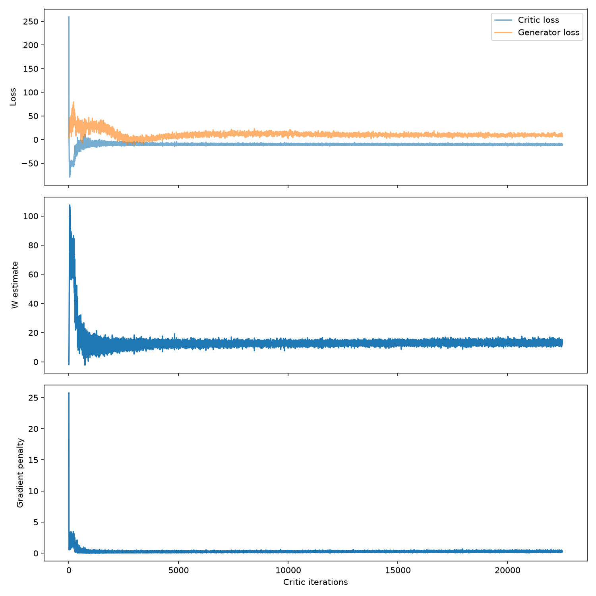
### Figure 4: WGAN-GP Tuned Losses per Iteration

The gradient penalty behaves very similary to the standard WGAN run, dropping quickly to a low penalty and remaining there for the duration of training. The Wasserstein estimate starts much higher, then falls and settles into a narrower band than the standard run. While the W values cannot be directly compared since the critic's scale depends on the data, it suggests that the critic estimates are steadier.

### 5.2 Generated Samples
All grids below are uncurated, and display the first 32 samples produced from random seed 1, with no selection. Additional seed 2 and 3 images are available within the respective model subfolder of `images/`.

| Real Test Slices (Centre Crop) | DCGAN |
|---|---|
| 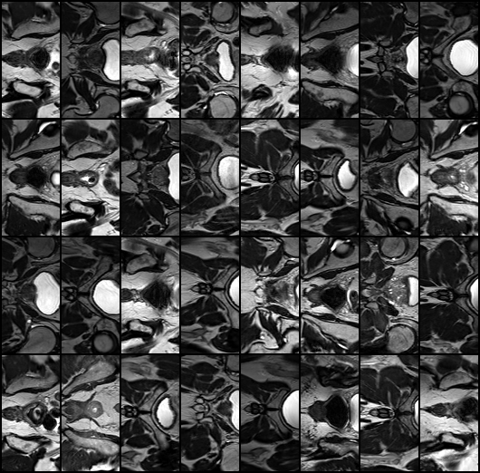 | 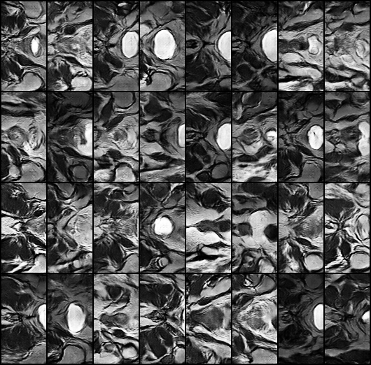 |
### Figure 5: Real Images vs Generated DCGAN Images

The DCGAN image generations appear to have relatively sharp and clean boundaries, with nice contrasting edges between bright/dark areas. Additionally, the bladders are smooth, with similarity in shape and brightness to the real images. However, the global anatomical layout is lacking, with no consistent arrangement of organs and little symmetry between the left and right sides of the pelvis. Some images appear to be mostly texture (row 2, column 1-3) with no distinct layout at all.

| Real Test Slices (Centre Crop) | WGAN Standard |
|---|---|
|  | 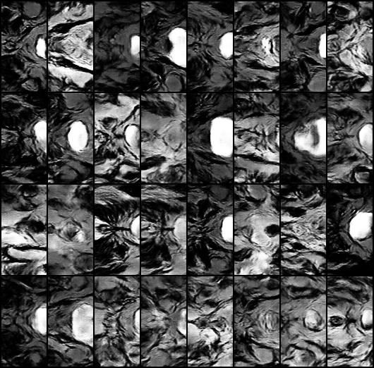 |
### Figure 6: Real Images vs Generated Standard WGAN-GP Images

The standard WGAN-GP is able to reproduce global intensity and contrast, and places a bright bladder-like structure to the right in approximately half of its samples. However, it is not able to reproduce anatomical structure, as the bladder boundaries are irregular and surrounding tissue can have swirling patterns instead of distinct muscles/organs. Some samples contain no recognisable structure, but all samples vary noticably in layout with no obviously similar compositions. Compared to the DCGAN, this generator produces blurrier, streaky edges and a more irregular bladder appearance, suggesting that the baseline model has outperformed the standard WGAN-GP implementation.

| Real Test Slices (Downsampled) | WGAN-GP (Tuned) |
|---|---|
| 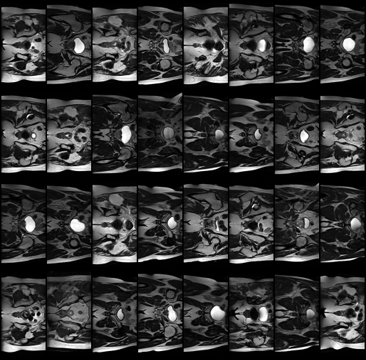 | 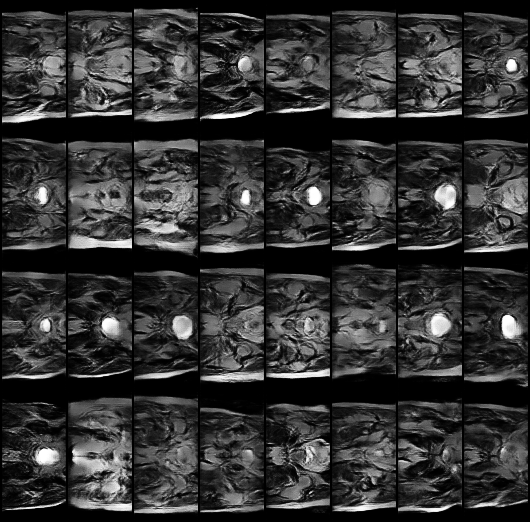 |
### Figure 7: Real Images vs Generated Tuned WGAN_GP Images

The global layout of the generated samples are improved in the tuned WGAN-GP, with roughly the right body width, and a bladder centred in the pelvis, which is a direct improvement when compared to the other two models. Additionally, the layouts are diverse, with relatively plausible bladders that vary in brightness and size. There are still some aspects missing, including a need for clearer structure (tissue between the outline and the bladder is streaky) and a lack of contrast and sharpness (some images appear fuzzy).

### 5.3 Tuned WGAN-GP
After the first two models were trained using a cropped version of the dataset, the final version of the WGAN was
trained using images cropped to 256x128 and then downsampled to 128x64. Additionally, the latent dimension and the generator feature 
widith were both increased to 128, as it was believed that more dimensions and channels would allows the generator to more easily 
separate aspects of a slice (i.e. bladder size, position, tissue) and more easily represent distinct features, respectively.

## 6. Results
### 6.1 Quantitative Benchmark
All metrics are computed on the held-out test split (540 slices, 3 patients) using each run's
checkpoint selected by lowest validation FID. 540 samples are generated per model with the same
latent noise (seed 0). Each model is evaluated against test and training data preprocessed the
same way it was trained.

| Metric | DCGAN | WGAN-GP (standard) | WGAN-GP (tuned) |
|---|:---:|:---:|:---:|
| Data | Centre crop | Centre crop | Whole slice, downsampled |
| Checkpoint (generator updates) | Epoch 50 (4,500) | Epoch 240 (4,320) | Epoch 250 (4,500) |
| **Fidelity** | | | |
| FID ↓ | **177.5** | 271.4 | 204.0 |
| Real-data FID floor | 79.8 | 79.8 | 70.4 |
| FID above floor ↓ | **97.7** | 191.7 | 133.6 |
| Inversion SSIM ↑ (mean ± std) | 0.374 ± 0.072 | 0.364 ± 0.078 | **0.547 ± 0.037** |
| Test slices with inversion SSIM > 0.6 | 0% (0 / 540) | 0% (0 / 540) | **11.1% (60 / 540)** |
| Meets SSIM > 0.6 target (mean) | ✗ | ✗ | ✗ |
| **Memorisation audit** | | | |
| Median NN RMSE to training set (generated) | 0.467 | 0.445 | 0.333 |
| Median NN RMSE to training set (real test) | 0.356 | 0.356 | 0.315 |
| Generated / real NN ratio | 1.31 | 1.25 | 1.06 |
| Samples closer than 99% of real test slices (expected ≈ 1% by chance) | 0.2% (1 / 540) | 0.4% (2 / 540) | 2.4% (13 / 540) |

Between the two centre-crop models, DCGAN achieves a much better FID than the standard WGAN-GP (97.7 versus 191.7 above real data floor), but both achieve a very similar SSIM. This indicates that neither generator can properly represent unseen patient anatomy well. While both models were compared against test images cropped in the same way, a likely cause of the very low SSIM score is the cropping of the images. Meanwhile the tuned WGAN-GP reaches an average SSIM of 0.547, with 11.1% of slices exceeding 0.6. While this also does not meet the requirements for generated data, it is much closer in proximity to the > 0.6 requirement, with only changes in image cropping and latent space/feature size changes having been made. This suggests that there is a likely change further tuning and exploration of the WGAN-GP model could meet the requirements for generated patient images.

### 6.2 Inverse SSIM
MRI images are too different in structure (varied anatomy) to obtain a valid SSIM score by comparing a generated image with a set of test images and returning the maximum SSIM score. Due to this, GAN inversion is used to "reconstruct" test slices. This is achieved by optimising a latent vector z so that G(z) matches the slice, and then the SSIM is computed between the slice and its reconstruction.

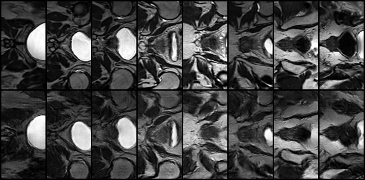

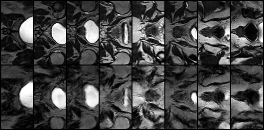

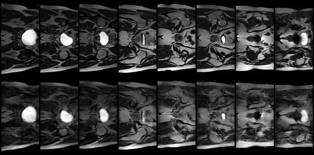
### Figure 8: DCGAN (Top) Standard-WGAN (Middle) Tuned WGAN-GP (Bottom) Inversion

The reconstruction (test slices on top, inversions on bottom), show that all generators can recover a coards structure of bladder position, brightness levels, and primary dark/bright regions. The tuned model accurately reproduces the the body outline, background and bladder, which is a likely cause of the higher SSIM score, but the internal tissue is smoothed out and low in contrast. DCGAN's reconstructions are visibly sharper than those of the standard WGAN-GP, but the achieved SSIM is similar, suggesting that DCGAN may face more misalignments in texture despite being sharper in appearance.

### 6.3 Memorisation Audit
The memorisation images below show the 8 generated samples (bottom row) from each model that were closest to images in the training set (top row), illustrating the worst cases of memorisation discovered.

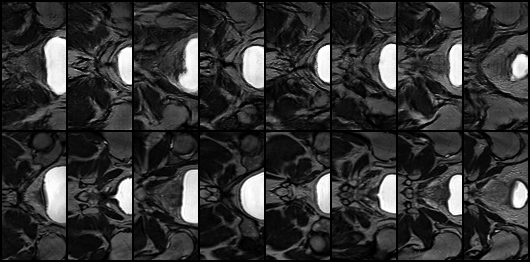

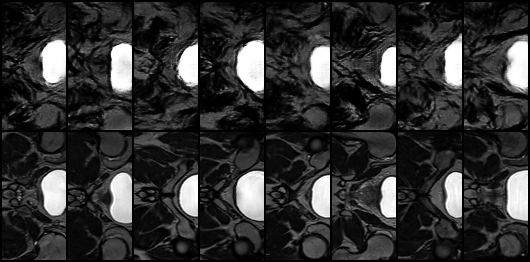

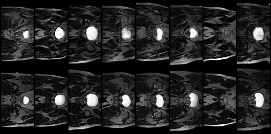
### Figure 9: DCGAN (Top) Standard-WGAN (Middle) Tuned WGAN-GP (Bottom) NN Slices

In all 3 cases, matches appear to come from the dominant shape being similar, rather than because the internal anatomy of the patients is directly copied. More specifically, each image features a large, bright bladder in the same position, making it dominating feature across the image. Thus, "similar" generated/real pairs are those where the generated bladder happens to be large, rather than due to copied anatomy across the whole image (i.e. generated tissue, muscles and bones differ).

The tuned model has the highest percentage of samples below the memorisation threshold (2.4%, when the expected would be 1% with random chance). To properly analyse why this may be, we can take a look at the histogram produced by the `test` function in `train.py`. The histogram compares 540 real test slices to 540 generated images, and for each generated image it finds the most similar training slice and measures how different they are with average pixel difference. A small number is located on the left-hand side, and indicates that an image is very similar to a training slice, while the right-hand side means they are less similar.

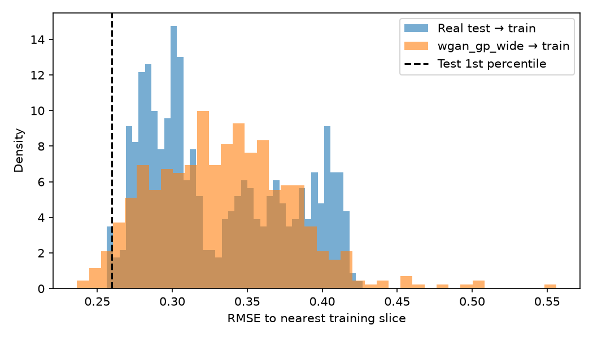
### Figure 10: Tuned WGAN-GP NN Histogram

The generated distribution overlaps the real distribution but is centred slightly to the right of it, suggesting that generated images are actually slightly less like any real slice. There are still very few images are to the left of the percentile line marker, and they are only more similar to train images by a small margin (roughly 0.13 lowest generator RMSE versus rouhgly 0.27). Moreover, the generated images actually have more images farther right than the test images, so it is likely that the increased similarites occured due to very similar global anatomy, rather than due to any direction training memorisation.

### 6.4 Latent Space Interpolation
Interpolation strip between two latent vectors; smoothness and anatomical
plausibility.
### 6.5 Resource Profiling
Table: parameters, peak VRAM, time per epoch, time per generator update,
generation latency, GPU.

## 7. Failure Analysis
3–5 representative failure cases, each with image, diagnosis and likely cause
(e.g. checkerboard artefacts, incoherent anatomy, partial mode collapse).

## 8. Recommendation
Evidence-based verdict to the project manager: is WGAN-GP worth its extra cost,
is it safe to share (memorisation), and what would be needed before deployment.
### 8.1 Limitations & Future Work
Small test set (3 patients), FID on greyscale MRI, 2D only, etc.

## 9. AI Use Disclosure
What tools were used, for what, and how outputs were verified.

## 10. References
Arjovsky et al. 2017; Gulrajani et al. 2017; Radford et al. 2016;
PyTorch DCGAN tutorial; HipMRI dataset source.
